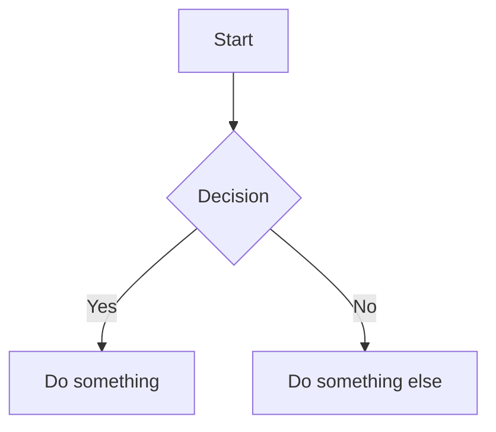
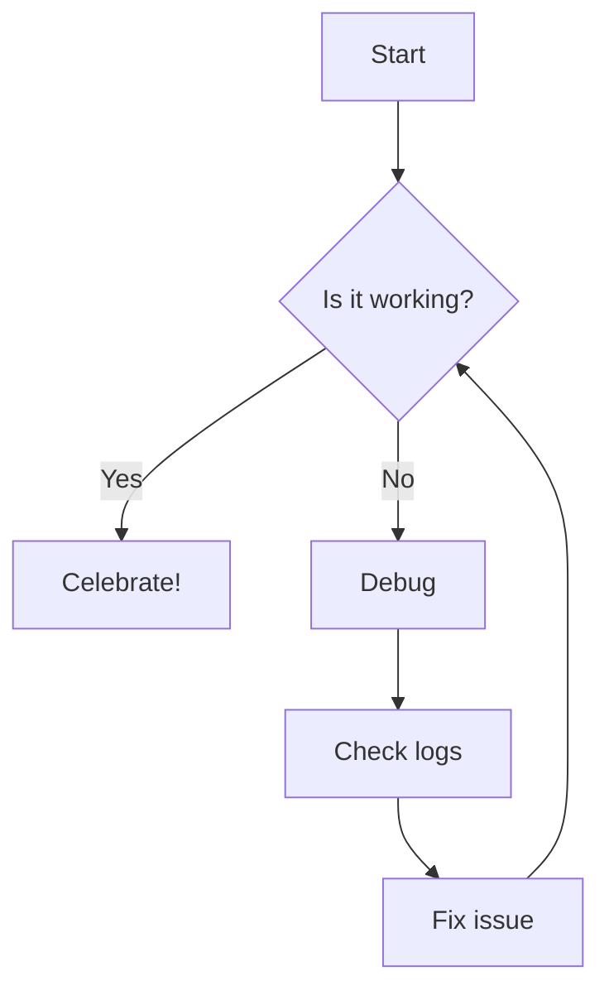
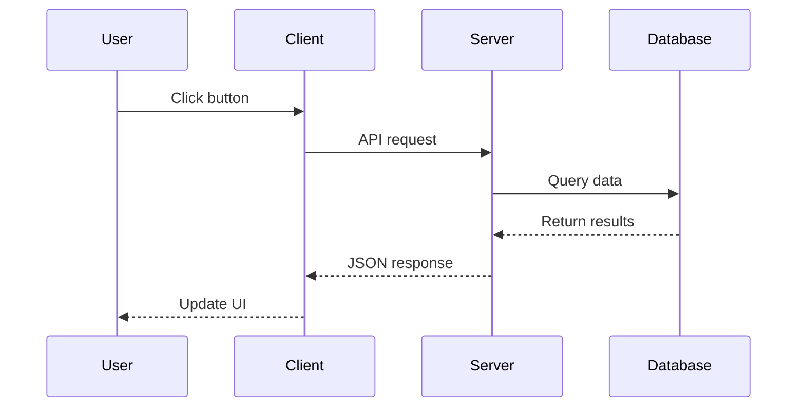
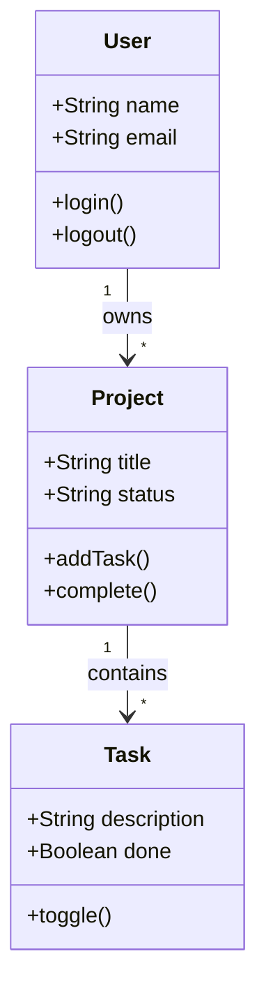
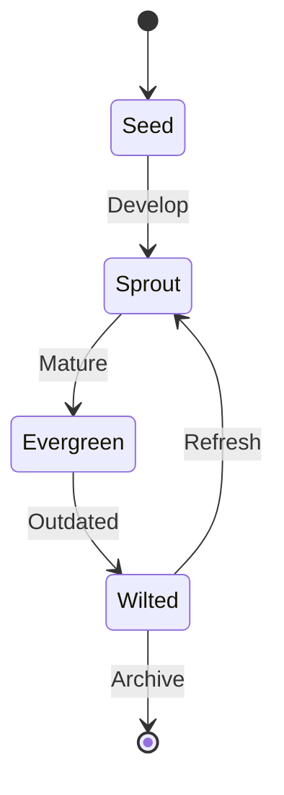
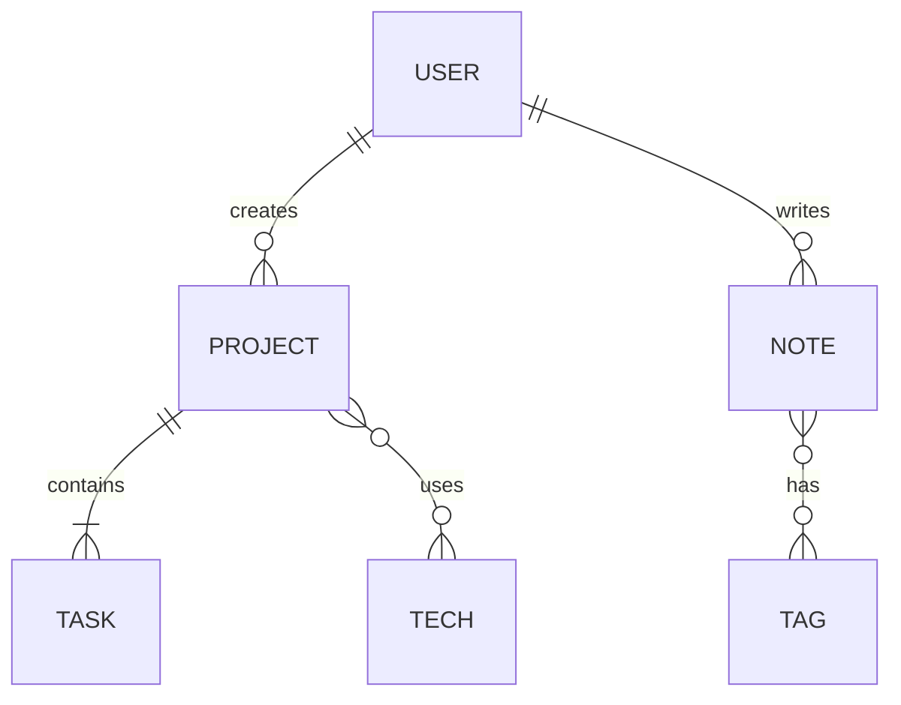
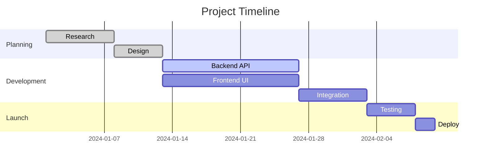
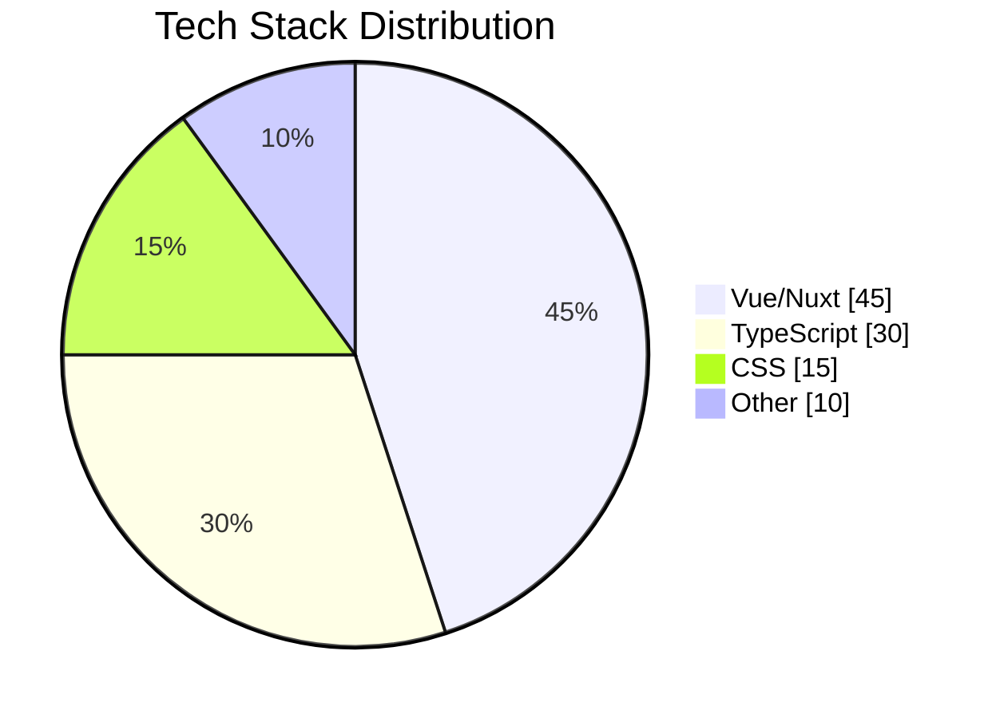
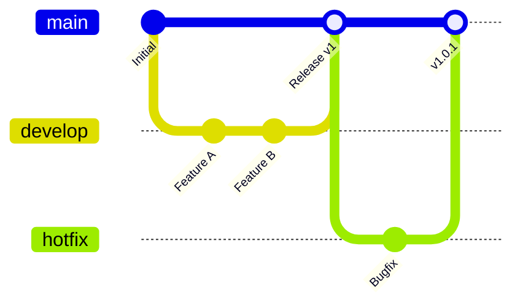

Kickstart supports [Mermaid](https://mermaid.js.org/) diagrams directly in your markdown content. Mermaid lets you create diagrams and visualizations using text-based definitions.

## Basic Usage

Use standard markdown code fences with `mermaid` as the language:

````md

````

## Flowchart Example



## Sequence Diagram



## Class Diagram



## State Diagram



## Entity Relationship Diagram



## Gantt Chart



## Pie Chart



## Git Graph



## Theme Support

Diagrams automatically adapt to your current color mode (light/dark). Switch themes to see the diagrams update.

## Tips

- Keep diagrams simple and focused on one concept
- Use meaningful labels for nodes
- Test complex diagrams in the [Mermaid Live Editor](https://mermaid.live/)
- Diagrams are print-friendly and will render in PDFs
